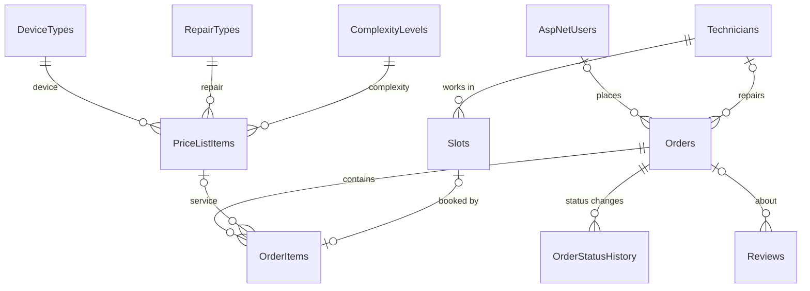

# Repair Service Center


A web platform for a service center that repairs smartphones, tablets, laptops and home appliances.
Customers find a service and its price, book a free time of a technician online and track the repair.
The staff manage the price list, the schedule, the requests and the reviews in one place.

This is the course project for the discipline **Web Technologies** (Khmelnytskyi National University).
The project grows step by step: every laboratory work (LW 1–8) adds a new part and has its own Git tag.

## Features

**Everybody (guests too)**

- **Services & prices** – a catalog of the price list with text search, filters (device type, repair type,
  complexity, price from / to) and sorting (price, price descending, duration, popularity).
  The search parameters stay in the address, so a result can be saved or sent.
- **Service page** – price, duration, description and other services for the same device.
- **Track request** – find a request by its number and phone number and see its status history.
- **Reviews** with the average rating, and the **About us** page with the technicians from the database.
- **Two languages** – English and Ukrainian (EN / UA switcher in the menu).

**Customer**

- Sign up, log in, edit the profile (name and phone).
- **Request a repair**:
  - *standard request* – a service from the price list and a free 2-hour slot of a technician
    (the next 14 days). The price is known, the status is `Accepted`;
  - *custom request* – the customer describes the problem. The status is `Pending`,
    the administrator sets the price later.
- A confirmation page that can be printed, and the page **My requests**.
- Write a review. It is published only after moderation.

**Moderator**

- **Reviews moderation** – approve, hide or delete a review.

**Administrator**

- **Orders** – search by name, phone, e-mail, device brand and model; filters by status, technician and dates;
  every change of the status is saved in the status history.
- **Price list** and **directories** (device types, repair types, complexity levels, technicians) with full CRUD.
- **Time slots** – CRUD and the button that fills the schedule of all technicians for the next 7 days.
- **Users and roles** – change the role of a user.
- Moderation of reviews (the same as the moderator).

The life cycle of a request: `Pending → Quoted → Accepted → In Progress → Ready → Issued`.

### Main business rules

- The slots start at 10:00, 12:00, 14:00 and 16:00, Monday to Saturday, and last 2 hours.
- One slot can be booked only once. The application checks it before saving,
  and a unique index in the database stops a double booking at the same moment.
- The price and the duration are copied from the price list into the request,
  so a new price does not change old requests.
- A record that is used by other records (for example, a service in a request or a booked slot)
  cannot be deleted. The administrator sees a message with the reason.

## Tech stack

| Part | Technology |
| --- | --- |
| Language, platform | C#, .NET 10 |
| Web | ASP.NET Core MVC, Razor views, tag helpers, partial views |
| Data | Entity Framework Core 10 (Code First, migrations, Fluent API), MS SQL Server LocalDB |
| Security | ASP.NET Core Identity (roles and policies), anti-forgery tokens, `[Bind]` against overposting |
| Validation | Data annotations, own attributes for the server and the client, jQuery Validation |
| Localization | `.resx` files, `IStringLocalizer`, `IHtmlLocalizer`, `IViewLocalizer` |
| UI | Bootstrap 5 with an own theme, own SVG images, responsive layout |
| Tools | JetBrains Rider, Git, GitHub |

## Getting started

### Requirements

- [.NET 10 SDK](https://dotnet.microsoft.com/download)
- SQL Server LocalDB (Windows; it is installed with Visual Studio or SQL Server Express).
  Check it with `sqllocaldb info`.
- EF Core command-line tools:

  ```bash
  dotnet tool install --global dotnet-ef
  ```

### Run

```bash
git clone https://github.com/kuzmynets/Repair-Service-Center.git
cd "Repair-Service-Center/Repair Service Center"

dotnet ef database update            # creates the database RepairServiceCenter with demo data
dotnet run --launch-profile https
```

Open <https://localhost:7275> (or <http://localhost:5087>).

In Rider: open `Repair Service Center.slnx`, choose the profile `https` and press **Run**
(the command `dotnet ef database update` is still needed once).

At the first start the application creates the roles and the demo accounts
and fills the schedule of the technicians for the next 7 days.

The connection string is in `appsettings.json` (`ConnectionStrings:RepairServiceContext`).
To use another database without changing the file, set the environment variable
`ConnectionStrings__RepairServiceContext`.

### Demo accounts

| Role | E-mail | Password |
| --- | --- | --- |
| Admin | `admin@example.com` | `Admin2026` |
| Moderator | `moderator@example.com` | `Moder2026` |
| Customer | `anna.shevchenko@example.com` | `Anna2026` |

A new customer can also sign up. A password needs at least 8 characters, a digit and a small letter.
After 5 wrong passwords the account is locked for 5 minutes.

### Language

The site opens in English. The language is changed with the **EN / UA** switcher in the menu
(the choice is saved in a cookie for one year) or with `?culture=uk-UA` in the address.
The interface, validation messages and Identity messages are translated;
the data from the database (names of services, reviews) is not translated.

## Project structure

```text
Repair-Service-Center/
├── Repair Service Center.slnx
└── Repair Service Center/          ASP.NET Core MVC project
    ├── Controllers/                public pages, account, admin panel (CRUD), language
    ├── Data/                       RepairServiceContext, IdentitySeed, SeedData
    ├── Helpers/                    UiHelper, languages, translated Identity messages
    ├── Migrations/                 EF Core migrations
    ├── Models/                     entities, OrderStatus, ViewModels/
    ├── Resources/                  translations (.uk.resx): shared file and one file per view
    ├── Validation/                 own validation attributes (server and client)
    ├── Views/                      Razor views, Shared/_Layout.cshtml, partial cards
    ├── wwwroot/                    CSS, JavaScript, SVG images, libraries
    ├── Program.cs                  services, middleware, routes
    └── appsettings.json            connection string
```

## Database

Ten tables of the application and the standard tables of ASP.NET Core Identity (`AspNetUsers`, `AspNetRoles`, …).



- **Initial data.** The directories, the price list, three technicians, demo requests and reviews
  are added by `HasData` in the migrations. The time slots depend on today's date,
  so `SeedData` creates them when the application starts.
- **Migrations:** `InitialCreate` (LW 2), `AddSlotsOrderItemsHistoryReviews` (LW 4),
  `AddSearchFields` (LW 5), `AddIdentity` (LW 6), `AddAddresses` (LW 7).

## Laboratory works

| LW | Topic | What was done | Tag |
| --- | --- | --- | --- |
| 1 | Simple ASP.NET Core MVC application | Technical specification, MVC project, the page with the data of the student (`/Home/Author`) | [`LW_1`](https://github.com/kuzmynets/Repair-Service-Center/tree/LW_1) |
| 2 | Models, controllers, views (CRUD) | EF Core and LocalDB, 6 models, Fluent API, test data, CRUD for the directories, price list and orders | [`LW_2`](https://github.com/kuzmynets/Repair-Service-Center/tree/LW_2) |
| 3 | User interface | Public site: home page, catalog, service page, request form, confirmation, About us; own Bootstrap theme and SVG images | [`LW_3`](https://github.com/kuzmynets/Repair-Service-Center/tree/LW_3) |
| 4 | Work with the database | Slots, order items, status history, reviews; relations and unique indexes; booking of a time; review moderation | [`LW_4`](https://github.com/kuzmynets/Repair-Service-Center/tree/LW_4) |
| 5 | Search | New fields (e-mail, brand, model, experience); search in the catalog, orders and technicians; Track request | [`LW_5`](https://github.com/kuzmynets/Repair-Service-Center/tree/LW_5) |
| 6 | Authorization by roles | ASP.NET Core Identity; roles Customer, Moderator, Admin; policies; My requests; Users and roles | [`LW_6`](https://github.com/kuzmynets/Repair-Service-Center/tree/LW_6) |
| 7 | Validation | Own attributes for name, phone, e-mail, address and date on the server and the client; `IValidatableObject` for slots | [`LW_7`](https://github.com/kuzmynets/Repair-Service-Center/tree/LW_7) |
| 8 | Localization | English and Ukrainian, language switcher, `.resx` files, translated validation and Identity messages | [`LW_8`](https://github.com/kuzmynets/Repair-Service-Center/tree/LW_8) |

To see the project as it was after a laboratory work:

```bash
git switch --detach LW_4    # the state of LW 4
git switch master           # back to the last version
```

An old tag has an older database schema, so it is better to run it with its own database
(PowerShell, in the folder of the `.csproj` file):

```powershell
$env:ConnectionStrings__RepairServiceContext = "Server=(localdb)\mssqllocaldb;Database=RepairServiceCenter_LW4;Trusted_Connection=True;MultipleActiveResultSets=true;TrustServerCertificate=True"
dotnet ef database update
dotnet run
```

## Branch `oop`

The branch `oop` has laboratory works of the OOP course that use the same project:

- **LW 5, modules.** Small helpers (`EnumExtensions.GetDisplayName`, `RatingFormatter.Stars`,
  `DurationFormatter.Format`) are moved to the class library `RepairServiceCenter.Common`.
  The library is packed as the NuGet package `Didyk.RepairServiceCenter.Common`, and the web application uses this package.
- **LW 6, dependency injection.** `IClock` / `SystemClock` (Singleton) and
  `IRepairRequestService` / `RepairRequestService` (Scoped): the booking logic is moved from the controller to a service.
  The console project `DiLibrariesDemo` builds the same objects with Microsoft.Extensions.DependencyInjection, Autofac and Scrutor.

The web application in this branch needs the package from a local folder. Create it once, in the root folder of the repository:

```bash
dotnet pack RepairServiceCenter.Common -c Release -o packages
dotnet nuget add source "$PWD/packages" --name RepairServiceCenterLocal
```

## Author

**Maksym Didyk**, group SEs-26-1, Khmelnytskyi National University, 2026.
